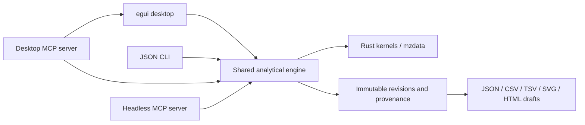

# Chromascope

**Let an AI assistant drive your LC-MS analysis — while every number stays traceable.**

Chromascope is a free, open-source LC-MS workbench written in Rust. Open mzML data, draw chromatograms and spectra, integrate peaks, build calibration curves, quantify and run QC. Use it like a normal desktop app, script it from the command line, or hand the controls to an AI assistant over [MCP](https://modelcontextprotocol.io). The assistant does the reasoning; Chromascope does the maths, keeps the evidence and records exactly what happened.

https://github.com/user-attachments/assets/cfbe286f-962d-41b3-ad6f-ffa3f33bebf3

<sub>Video not playing? Open [assets/demo.mp4](assets/demo.mp4) directly. It shows an AI client opening a file, extracting an XIC and previewing an integration in the Chromascope window; nothing is changed permanently.</sub>

## Documentation

- **Website and user manual: <https://chromascope-ms.github.io/chromascope/>**
- **[MCP guide](https://chromascope-ms.github.io/chromascope/mcp/)**: set up an AI assistant, what it can do, ready-to-paste prompts, safety.
- [Getting started](https://chromascope-ms.github.io/chromascope/get-started/getting-started/): a ten-minute tutorial with the example file in `test_file/`.
- [CHANGELOG.md](CHANGELOG.md) and [examples/README.md](examples/README.md).

## Install

1. Download the installer for your system from the [releases page](https://github.com/chromascope-ms/chromascope/releases/latest): `.msi` or portable `.zip` (Windows), `.dmg` (macOS), `.deb`, `.rpm`, `.AppImage` or `.tar.gz` (Linux).
2. The builds are not code-signed. On Windows choose *More info*, *Run anyway* in SmartScreen; on macOS use *System Settings*, *Privacy & Security*, *Open Anyway*.
3. Start Chromascope, choose **File**, **Open data…**, and follow the [tutorial](https://chromascope-ms.github.io/chromascope/get-started/getting-started/).

Details for every system, the checksums and building from source are on the [download page](https://chromascope-ms.github.io/chromascope/get-started/download/). The desktop program checks GitHub once a day for a newer version; see [Settings](https://chromascope-ms.github.io/chromascope/manual/settings/#update-check) to turn that off.

## What is in the package

| Program | What it is |
|---|---|
| `chromascope` | The desktop app |
| `chromascope-cli` | The same analysis engine as JSON on the command line |
| `chromascope-mcp` | The desktop app as an MCP server: an AI assistant works in a visible window (74 tools) |
| `chromascope-engine-mcp` | A window-less MCP server with the 14 calculation tools, for scripts and servers |

One engine sits behind all four, so a number from the window is the number from the CLI and from the assistant. Raw files are never modified, and results keep their units, settings, software versions and source hashes.

Chromascope is not validated on instruments and does not certify regulatory compliance; read the [limitations](https://chromascope-ms.github.io/chromascope/manual/limitations/).

## Development

```sh
cargo fmt --all -- --check
cargo clippy --locked --all-targets -- -D warnings
cargo clippy --locked --all-targets --all-features -- -D warnings
cargo test --locked
cargo test --locked --features mcp
cargo test --locked --no-default-features --features mcp-headless
cargo test --locked --all-features
```

The package needs Rust 1.88 or newer. On Ubuntu the window also needs `libxcb-render0-dev libxcb-shape0-dev libxcb-xfixes0-dev libxkbcommon-dev`. The website is in `website/` (MkDocs Material); build it from the repository root with `pip install -r website/requirements.txt` and `mkdocs build --strict -f website/mkdocs.yml`. See [contributing](.github/CONTRIBUTING.md): a change to the window or to the MCP tools updates the manual and the MCP guide in the same commit.



## Licence

Licensed under [GPL-3.0-only](LICENSE). [THIRD_PARTY_LICENSES.txt](THIRD_PARTY_LICENSES.txt) lists the notice of every dependency and of the embedded Inter and JetBrains Mono fonts.
