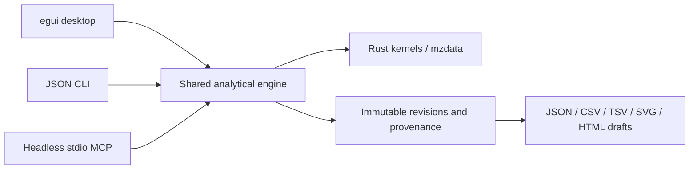

# Chromascope

**Let an AI assistant drive your LC-MS analysis — while every number stays traceable.**

Chromascope is an open-source LC-MS workbench written in Rust. You can use it like a normal desktop app, script it from the command line, or hand the controls to an AI assistant over [MCP](https://modelcontextprotocol.io). The assistant does the reasoning; Chromascope does the maths, keeps the evidence and records exactly what happened.

https://github.com/user-attachments/assets/cfbe286f-962d-41b3-ad6f-ffa3f33bebf3

<sub>Video not playing? Open [assets/demo.mp4](assets/demo.mp4) directly.</sub>

### What you are seeing in the demo (32 seconds)

On the left is an ordinary AI chat client. On the right is the Chromascope desktop. The only thing typed is a plain-English request: *open `8.mzML`, extract the XIC for m/z 258.1109 (10 ppm), zoom into the main peak around 3.2 min, smooth it moderately, propose integration boundaries and calculate the area without making permanent changes.*

1. **0–10 s: the assistant opens the data itself.** The empty viewer fills with a loaded file and a freshly extracted XIC. The assistant works through Chromascope's own tools while the GUI updates live.
2. **10–22 s: it zooms in and compares.** The raw trace (blue) and a smoothed copy (orange) appear side by side, so the effect of smoothing is visible rather than assumed.
3. **25–32 s: it inspects, then reports.** The two traces are overlaid, and the assistant answers: *apex at 3.1935 min, proposed boundaries 3.11–3.36 min, area 409,563.44 a.u.·min with a straight-chord baseline.*
4. **The last line matters most.** The area was calculated with `integrate(apply=false)`, a preview. The assistant proposed a result; it did not silently change your data.

Not shown in the video: the same engine also runs targeted quantification and QC, from the GUI, the CLI or an AI client.

### Why you might care

- **AI as a lab assistant, not a black box.** Models inspect, propose and prepare drafts. Similarity scores never confirm an identity, and a reviewer's acknowledgement cannot turn a failing QC rule into a pass.
- **Everything is auditable.** Raw files are never modified. Results keep their units, parameters, software versions and source hashes, and project history is append-only.
- **One engine, three front ends.** The desktop app, JSON CLI and MCP servers share the same analysis code, so a number from the GUI is the number from the CLI.
- **Honest about gaps.** Missing runtimes give explicit errors, not quiet fallbacks. [Limitations](#analytical-capabilities-and-limitations) are listed in plain sight.

### What you can do with it

| Workflow | Highlights |
|---|---|
| **Explore** | TIC / BPC / XIC, overlays and grids, spectrum inspection, full-resolution peak integration |
| **Quantify** | Weighted calibration, internal standards, qualifiers, dilution, batch QC rules |
| **Deliver** | Verified project bundles and draft reports (JSON, CSV, TSV, SVG, HTML) |

### Quick start

Download an installer or archive for your system from the [Releases page](https://github.com/adamcseresznye/chromascope/releases) (see [Installation](#installation) for what to expect on first launch), or build from source:

```sh
cargo build --locked --release --bin chromascope
target/release/chromascope        # chromascope.exe on Windows
```

Open an mzML file from **File**, pick **XIC**, and double-click a trace to see its spectrum. To let an AI client drive it, see [MCP setup](#mcp-setup-and-ai-assisted-analysis). Other builds (CLI-only, headless MCP) are listed under [Installation](#installation).

> **Status:** version `0.3.0`. Not instrument-validated. Installers and archives are published on the [Releases page](https://github.com/adamcseresznye/chromascope/releases). See the [feature matrix](docs/FEATURE_STATUS.md), [release notes](docs/RELEASE_NOTES.md), [changelog](CHANGELOG.md), [validation report](docs/VALIDATION_REPORT.md) and [backlog](docs/RELEASE_BACKLOG.md).

## Architecture

One Rust package provides typed `domain` requests, `engine::execute`, bounded `jobs`, append-only `project` revisions and `delivery`. GUI, CLI and headless MCP use shared chromatography, targeted quantification and QC modules. Legacy viewer/desktop MCP paths retain shared parser/processing kernels and GUI presentation state. View commands require the desktop; headless analysis does not.



[Architecture](docs/ARCHITECTURE.md) contains historical design and subsequent implementation contracts. The [roadmap](docs/IMPLEMENTATION_ROADMAP.md) tracks unfinished acceptance gates.

## Installation

### Installers and archives

Each release provides the desktop app together with the command-line interface and both MCP servers (`chromascope-cli`, `chromascope-mcp`, `chromascope-engine-mcp`). The builds are **not code-signed**, so each operating system shows a warning the first time.

| System | Download | First launch |
|---|---|---|
| **Windows** (x64, arm64, x86) | `chromascope-<version>-windows-<arch>.msi`, or `…-portable.zip` that needs no install | The MSI installs for **all users**, so Windows asks for administrator approval. SmartScreen reports an unknown publisher: choose **More info → Run anyway**. The installer adds its folder to `PATH`, so open a new terminal to use `chromascope-cli`. |
| **macOS** (Apple silicon and Intel) | `chromascope-<version>-macos-universal.dmg`, or the `.zip` | Drag **Chromascope** to **Applications**. The app is not notarised: open it once, dismiss the warning, then go to **System Settings → Privacy & Security** and choose **Open Anyway** (macOS 15 and later no longer offer right-click → Open). |
| **Linux** (x86_64, aarch64) | `chromascope-<version>-linux-<arch>.deb`, `.rpm`, `.AppImage` or `.tar.gz` | `sudo apt install ./chromascope-…deb`, `sudo dnf install ./chromascope-…rpm`, or `chmod +x` the AppImage (it needs FUSE, or run it with `--appimage-extract-and-run`). |

Every package contains the GPL-3.0 [LICENSE](LICENSE) and `THIRD_PARTY_LICENSES.txt`, the licence notices of the embedded fonts and the Rust dependencies. The release page also lists `SHA256SUMS.txt`. Release asset names changed from v0.2.0, which published only the GUI binary: use the new names above.

### Building from source

The package declares **Rust 1.88** as its minimum, and CI compiles every target on exactly that version. Build with a compatible Rust toolchain, a platform C/C++ linker/toolchain and the checked-in lockfile:

```sh
cargo build --locked --release --bin chromascope
cargo build --locked --release --no-default-features --bin chromascope-cli
cargo build --locked --release --no-default-features --features mcp-headless --bin chromascope-engine-mcp
cargo build --locked --release --features mcp --bin chromascope-mcp
```

Run executables under `target/release/` (`.exe` on Windows). Default features enable the desktop. Linux GUI builds need platform development libraries; existing CI installs `libxcb-render0-dev libxcb-shape0-dev libxcb-xfixes0-dev libxkbcommon-dev`. See [installation details](docs/USER_GUIDE.md#installation).

mzML and mzML.gz open directly. Vendor import requires separately installed compatible ProteoWizard `msconvert` and supported vendor runtime/licenses; no universal vendor support is claimed.

| Optional capability | Operator-supplied runtime |
|---|---|
| Independent reference regeneration | Existing NumPy/SciPy/mpmath environment |

Nothing auto-installs. Missing/incompatible runtimes return explicit errors without numerical fallbacks. Preserve recorded runtime versions for replay.

## GUI workflows

1. Select **Data explorer** and open data with the file controls. Choose TIC/BPC/XIC and acquisition, polarity and mass filters. Retain traces for overlay/grid/stacked comparison. Double-click a trace for its spectrum; right-drag to integrate; middle-drag to box zoom. Integration uses full resolution rather than display decimation.
2. Select **Quantification and QC** for batch methods, peak diagnostics, boundary review and CSV. Expand **Targeted concentrations, calibration and QC** for standards/blanks/QC/unknowns, internal standards, qualifiers, calibration and dilution. Inspect flags and missing states before export.
3. Within targeted quantification, expand **Batch QC and method validation**. Load a study/report or prepare batch evidence, supply explicit rules, evaluate, inspect pass/fail/indeterminate results and acknowledge with reasons. Acknowledgement cannot make a failing rule pass.
4. Select **Audit package** to inspect the open project, verify its sources, configure a new draft report or portable bundle and reprocess retained results without replacing them.

The [user guide](docs/USER_GUIDE.md) covers established viewer controls; [examples](examples/README.md) and [project delivery](docs/PROJECT_DELIVERY.md) cover newer workspaces. **AI activity** shows desktop MCP session activity and launch permissions when connected. Some advanced settings use structured JSON editors. Native dialogs and end-to-end desktop workflows still need platform smoke testing.

## Verified media references

The [demonstration video](assets/demo.mp4) shows an AI client driving the desktop through MCP (XIC extraction, smoothing and a preview integration). It does not demonstrate the newer workspaces. Test-generated previews under `docs/ux-evidence/` are software-rendered egui fixtures, not native screenshots; no benchmark is asserted here.

Project toolbar **Create project…** / **Open project…** retains workspace snapshots. This recently integrated path remains experimental pending native/recovery acceptance.

## CLI examples

The CLI reads a version-1 request on stdin and returns `{ "ok": true, "result": ... }` or `{ "ok": false, "error": { "code": ..., "message": ... } }` with exit code 1. Progress goes to stderr. Use `-` for embedded-evidence operations. PowerShell, from the repository root after a debug build:

```powershell
'{"version":1,"operation_id":"703ee3bb-3a18-47b1-b51d-dfe001963bfe","actor":"local-analyst","operation":{"operation":"metadata"}}' | target/debug/chromascope-cli.exe run test_file/data_dependent_02.mzML
Get-Content examples/targeted-request.json -Raw | target/debug/chromascope-cli.exe run -
Get-Content examples/qc-request.json -Raw | target/debug/chromascope-cli.exe run -
python examples/release_workflows.py --cli target/debug/chromascope-cli.exe --output NEW_OUTPUT_DIRECTORY
```

The targeted starter contains **only an unknown** and cannot establish calibration or valid concentration. The QC starter contains authored demonstration inputs, not instrument-validation data. Supply real standards and justified settings for scientific use. The release helper retains hashes, requests, responses, logs and original/reviewed QC evidence; it also exercises the experimental spectral search, so it needs a CLI built with `--features experimental`. [Examples](examples/README.md) also cover full targeted/MCP workflows.

```powershell
target/debug/chromascope-cli.exe project-create NEW_PROJECT_DIRECTORY
'{"version":1,"operation_id":"703ee3bb-3a18-47b1-b51d-dfe001963bfe","actor":"local-analyst","operation":{"operation":"metadata"}}' | target/debug/chromascope-cli.exe run test_file/data_dependent_02.mzML NEW_PROJECT_DIRECTORY
target/debug/chromascope-cli.exe project-report NEW_PROJECT_DIRECTORY NEW_REPORT_DIRECTORY
target/debug/chromascope-cli.exe project-bundle NEW_PROJECT_DIRECTORY NEW_BUNDLE_DIRECTORY
target/debug/chromascope-cli.exe project-verify NEW_BUNDLE_DIRECTORY
```

`run DATASET PROJECT` registers the source and commits the response. New export paths are required. Bundles are directories containing inventory hashes, historical raw inputs and local software snapshots. Reports are review drafts; see [delivery/replay contracts](docs/PROJECT_DELIVERY.md).

## MCP setup and AI-assisted analysis

Configure a compatible client with an absolute executable and existing authorized data roots:

```json
{
  "mcpServers": {
    "chromascope-analysis": {
      "command": "C:/path/to/chromascope-engine-mcp.exe",
      "args": ["--allow-root", "C:/path/to/data"]
    }
  }
}
```

`analysis_capabilities` supplies generated request/response schemas and recipes. Use `discover_datasets`, `start_analysis`, `analysis_status`, paged `analysis_result`, `cancel_analysis`, `session_audit` and `prepare_analysis_report`. Jobs/audit are session-local; export before shutdown. `commit_analysis` additionally requires `--allow-project-writes`, an existing project/dataset, expected revision, actor and reason. Attributed actors are not authenticated human approvals. See [headless MCP contracts](docs/MCP_ANALYSIS.md).

For visual automation, `chromascope-mcp` hosts the desktop and keeps the original viewer and batch tools (31 tools). Change/export flags, roots and setup are in the [desktop MCP guide](docs/MCP.md) and [client example](examples/mcp-client.json).

```powershell
python examples/mcp_targeted_workflow.py YOUR_TARGETED_REQUEST.json NEW_AI_DRAFT --server target/debug/chromascope-engine-mcp.exe --qc-rules YOUR_RULES.json
```

Example agent instruction: inspect calibration and QC evidence, identify unresolved results, propose scientifically justified review actions, and prepare a draft retaining original quantities, flags and provenance. No model, hidden thresholds, automatic identity promotion or automatic human approval is built in.

## Experimental workflows

Spectral **Identification** (library search, formula and isotope evidence, annotations), **Untargeted analysis** (OpenMS feature detection and alignment) and **Statistics** (PCA, heatmaps, volcano plots, Welch tests) are implemented but not yet verified or manually tested. They are compiled into every build but hidden from the GUI, the headless MCP server and the CLI. Hidden operations are rejected with `experimental_unavailable`; projects that already contain their results still open. To try them, build with the `experimental` Cargo feature, for example `cargo build --features experimental`. Their runtimes are operator-supplied: pyOpenMS **3.5.0** via `CHROMASCOPE_OPENMS_PYTHON` for untargeted features, and Python >=3.11 with NumPy >=1.26,<3 and SciPy >=1.11,<2 via `CHROMASCOPE_STATS_PYTHON` for statistics.

## Analytical capabilities and limitations

Operational slices include chromatographic smoothing/baselines/noise/peak gates and reversible boundaries; weighted linear/quadratic calibration and dilution/qualifier/internal-standard checks, and explicit QC study metrics. Spectral identification, untargeted analysis and statistics exist as [experimental workflows](#experimental-workflows). The [complete status matrix](docs/FEATURE_STATUS.md) distinguishes implemented, partial, integrated, experimental and absent capabilities.

No DIA deconvolution, calibrated identity probability/FDR, general specialist lipid-fragment engine, paired/covariate/repeated-measures inference, authenticated approved-only release, PDF/raster report delivery or durable restartable general jobs is provided. Raw mzML source-unit preflight and full-run fallback bounds now have dedicated regression fixtures; comprehensive XML/binary/decompression validation remains open. Other risks include retained evidence/history memory growth, synchronous GUI replay/import, abandoned project locks and unverified OneDrive crash recovery. See [remaining defects](docs/REMAINING_DEFECTS.md) and [backlog](docs/RELEASE_BACKLOG.md). Synthetic/reference tests do not certify instruments or regulatory compliance.

## Reproducibility and development

Raw acquisitions are preserved. Results retain units, parameters, kernel/runtime identities and source hashes. Missing states remain explicit. Project commits append immutable revisions; review reasons and original evidence remain retained. Exact replay has operation-specific limits including generated IDs and external runtimes. Preserve full JSON, source files, lockfile and recorded environment, not CSV alone.

```sh
cargo fmt --all -- --check
cargo clippy --locked --all-targets --all-features -- -D warnings
cargo check --locked --all-features
cargo test --locked --all-features
cargo test --locked --no-default-features --features mcp-headless
cargo build --locked --all-features --bins
python tests/reference/verify_references.py NEW_REFERENCE_DIRECTORY
```

Tests cover kernels, real adapter/protocol/project integration, authored mzML and independent numerical references. Vendor/OpenMS/performance prerequisites are opt-in. Exact executed results and omitted gates are in [VALIDATION_REPORT.md](docs/VALIDATION_REPORT.md). CI declares a pinned scientific reference runtime, runs the tests on Linux, Windows and macOS, compiles every target on the minimum Rust version, and the release workflow runs the tests before it builds any installer.

Licensed under [GPL-3.0-only](LICENSE). Dependencies include egui/eframe, mzdata, mzsignal, nalgebra and the Rust MCP SDK. Embedded Inter and JetBrains Mono use the [SIL Open Font License](assets/fonts/inter/LICENSE.txt) ([JetBrains Mono](assets/fonts/jetbrains-mono/OFL.txt)); [THIRD_PARTY_LICENSES.txt](THIRD_PARTY_LICENSES.txt) lists every dependency's notice. Retained MassBank records carry per-record attribution in [spectral_sources.json](tests/reference/spectral_sources.json). See [contributing](.github/CONTRIBUTING.md).
