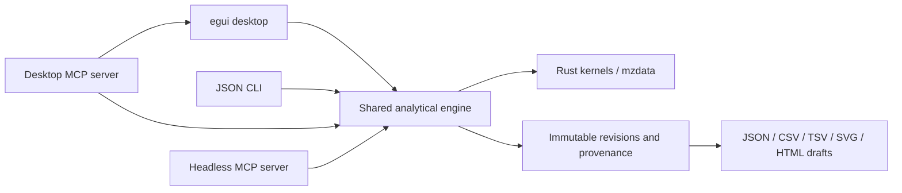

# Chromascope

**Let an AI assistant drive your LC-MS analysis — while every number stays traceable.**

Chromascope is an open-source LC-MS workbench written in Rust. You can use it like a normal desktop app, script it from the command line, or hand the controls to an AI assistant over [MCP](https://modelcontextprotocol.io). The assistant does the reasoning; Chromascope does the maths, keeps the evidence and records exactly what happened.

https://github.com/user-attachments/assets/cfbe286f-962d-41b3-ad6f-ffa3f33bebf3

<sub>Video not playing? Open [assets/demo.mp4](assets/demo.mp4) directly.</sub>

### What the demo shows (32 seconds)

On the left is an ordinary AI chat client, on the right the Chromascope desktop. The only thing typed is a plain-English request: *open `8.mzML`, extract the XIC for m/z 258.1109 (10 ppm), zoom into the main peak around 3.2 min, smooth it moderately, propose integration boundaries and calculate the area without making permanent changes.* The assistant opens the data, extracts the trace, compares the raw and the smoothed trace, and reports apex 3.1935 min, boundaries 3.11–3.36 min and an area of 409,563.44 a.u.·min with a straight-chord baseline. The area was calculated with `integrate(apply=false)`, a preview: the assistant proposed a result, it did not silently change your data. The video does not show quantification or QC, which run on the same engine.

- [Why you might care](#why-you-might-care)
- [Installation](#installation)
- [Quick start](#quick-start)
- [The four workspaces](#the-four-workspaces)
- [Working with data](#working-with-data)
- [Command line](#command-line)
- [MCP: let an AI client drive Chromascope](#mcp-let-an-ai-client-drive-chromascope)
- [Experimental workflows](#experimental-workflows)
- [Capabilities and limitations](#capabilities-and-limitations)
- [Development](#development)
- [Licences](#licences)

## Why you might care

- **AI as a lab assistant, not a black box.** Models inspect, propose and prepare drafts. Similarity scores never confirm an identity, and a reviewer's acknowledgement cannot turn a failing QC rule into a pass.
- **Everything is auditable.** Raw files are never modified. Results keep their units, parameters, software versions and source hashes, and project history is append-only.
- **One engine, three front ends.** The desktop app, the JSON CLI and the MCP servers share the same analysis code, so a number from the GUI is the number from the CLI.
- **Honest about gaps.** Missing runtimes give explicit errors, not quiet fallbacks. [Limitations](#capabilities-and-limitations) are listed in plain sight.

| Workflow | Highlights |
|---|---|
| **Explore** | TIC / BPC / XIC, overlays and grids, spectrum inspection, full-resolution peak integration |
| **Quantify** | Weighted calibration, internal standards, qualifiers, dilution, batch QC rules |
| **Deliver** | Verified project bundles and draft reports (JSON, CSV, TSV, SVG, HTML) |


## Installation

### Installers and archives

Each release provides the desktop app together with the command-line interface and both MCP servers (`chromascope-cli`, `chromascope-mcp`, `chromascope-engine-mcp`). The builds are **not code-signed**, so each operating system shows a warning the first time.

| System | Download | First launch |
|---|---|---|
| **Windows** (x64, arm64, x86) | `chromascope-<version>-windows-<arch>.msi`, or `…-portable.zip` that needs no install | The MSI installs for **all users**, so Windows asks for administrator approval. SmartScreen reports an unknown publisher: choose **More info → Run anyway**. The installer adds its folder to `PATH`, so open a new terminal to use `chromascope-cli`. |
| **macOS** (Apple silicon and Intel) | `chromascope-<version>-macos-universal.dmg`, or the `.zip` | Drag **Chromascope** to **Applications**. The app is not notarised: open it once, dismiss the warning, then go to **System Settings → Privacy & Security** and choose **Open Anyway** (macOS 15 and later no longer offer right-click → Open). |
| **Linux** (x86_64, aarch64) | `chromascope-<version>-linux-<arch>.deb`, `.rpm`, `.AppImage` or `.tar.gz` | `sudo apt install ./chromascope-…deb`, `sudo dnf install ./chromascope-…rpm`, or `chmod +x` the AppImage (it needs FUSE, or run it with `--appimage-extract-and-run`). |

Every package contains the GPL-3.0 [LICENSE](LICENSE) and `THIRD_PARTY_LICENSES.txt`, the licence notices of the embedded fonts and the Rust dependencies. The release page also lists `SHA256SUMS.txt`. Release asset names changed from v0.2.0, which published only the GUI binary: use the new names above. What changed in each version is in [CHANGELOG.md](CHANGELOG.md).

### Building from source

The package declares **Rust 1.88** as its minimum, and CI compiles every target on exactly that version. You need a compatible Rust toolchain, a platform C/C++ toolchain and the checked-in lockfile. On Ubuntu the GUI also needs `libxcb-render0-dev libxcb-shape0-dev libxcb-xfixes0-dev libxkbcommon-dev`.

```sh
git clone https://github.com/chromascope-ms/chromascope.git
cd chromascope
cargo build --locked --release --bin chromascope
cargo build --locked --release --no-default-features --bin chromascope-cli
cargo build --locked --release --no-default-features --features mcp-headless --bin chromascope-engine-mcp
cargo build --locked --release --features mcp --bin chromascope-mcp
```

Run the executables under `target/release/` (`.exe` on Windows). On Windows, close a running copy before rebuilding, or the linker cannot replace the file.

## Quick start

1. Start `chromascope` (`target/release/chromascope` when built from source).
2. **File → Open data…** opens an mzML or mzML.gz file; **File → Open dataset folder…** opens a vendor folder (see [vendor files](#vendor-files)). You can also drag files in. **File → Recent files** remembers the last 12.
3. Choose **TIC**, **BPC** or **XIC** in the toolbar. For an XIC, type a target m/z and a tolerance in ppm and click **Apply XIC**.
4. **Double-click** the chromatogram to see the mass spectrum of that scan, **right-drag** across a peak to integrate it, **middle-drag** to box-zoom.
5. To let an AI client do the same, see [MCP](#mcp-let-an-ai-client-drive-chromascope).

The header holds the **Analysis workflow** menu and the workspace tabs. **File → About Chromascope…** shows the version, the project links and the software and font licences.

## The four workspaces

| Tab | What it is for |
|---|---|
| **Data explorer** | Look at the data: file list, traces, spectra, measurements, figure export. |
| **Quantification and QC** | Batch methods, peak review, calibration and concentrations, batch QC and method validation. |
| **Audit package** | Inspect the open project, verify its sources, configure a draft report or a portable bundle, reprocess retained results without replacing them. |
| **AI activity** | Every call an MCP client made in this session, with its exact request, and the launch permissions it was given. |

### Data explorer

The file sidebar shows the active dataset, trace colours, visibility switches and import cancellation. The inspector on the right holds the extraction settings (acquisition, polarity, scan filter, mass range), smoothing, line appearance, retained traces and measurements. Drag the sidebar or inspector edge to resize it, and use **Panels** in the toolbar to hide the sample list, the trace settings or the spectrum (**Focus mode** hides all three).

- **Several traces.** Apply an XIC, enter the next target and apply again: earlier traces stay under **Traces** with their own colour. Visible traces appear as stacked panels with linked retention-time axes; **Grid layout…** sets rows and columns, **Overlay** draws everything in one plot, and **Compare samples** shows a matrix of samples (columns) by analytes (rows). **Scale** chooses individual axes, a shared highest peak or a shared custom maximum; this only changes the display.
- **Scan inspection.** Double-click selects the nearest scan; **Previous / Next**, the arrow keys or **Go** move between scans. **Acquisition details…** shows native ID, MS level, polarity, precursors, isolation and activation, scan windows and injection time.
- **Integration.** Every right-drag adds a measurement. **File → Integration results** lists them (file, trace and filter settings, bounds, area) and exports CSV. Clearing the selection does not remove measurements; `Esc` clears the selection.
- **Presets.** **File → Viewer presets → Preset editor…** builds a named set of analytes (acquisition FS/SIM/MRM, masses, ppm, smoothing, polarity). **Paste from Excel…** accepts tab-separated cells. TOML is the portable format behind the editor; see [`presets/example.toml`](presets/example.toml). The loaded preset applies to the whole batch of samples, including files opened later.
- **Sessions and export.** **File → Save viewer session** (`Ctrl+S`) writes a `.chromascope` file with sources, traces, filters, measurements, selected scans and layout; **Open viewer session** (`Ctrl+Shift+O`) restores it and reopens the sources. **File → Export → Figures (SVG)** writes the visible chromatograms or the spectrum as a vector figure at full resolution, independent of the zoom.
- **Display preferences.** **View** holds the theme (system, light, dark), the interface size (90, 100, 115 or 130 %) and the number of m/z decimals (2 to 6). They are kept in one `settings.json` in your user configuration directory; an unreadable field falls back to its default without resetting the others. Exports always keep full precision.

Right-click a chromatogram for file information, plot properties, presets, zoom reset, integration of the visible range, the measurement history, exports and hiding a panel.

### Quantification and QC

A separate workspace for measuring peak areas across samples. Integrations in the Data explorer and batch results are independent.

1. Add files or vendor folders and select the loaded runs under **Batch samples**.
2. **Edit method…** defines each analyte: name, FS/SIM/MRM acquisition, target and product m/z, optional precursor, ppm tolerance, polarity, MS level, expected RT and RT search window. Both editors offer **Save example preset…** (starters are built into the executable); see also [`presets/quantification-example.toml`](presets/quantification-example.toml).
3. **Run batch** extracts one sample and analyte at a time in a background worker; **Cancel** stops after the current extraction and marks the rest **Cancelled**.
4. Click a cell of the sample × analyte table to review the peak. **Next needing review** visits low-confidence, missing, failed, cancelled or outdated results. Drag a boundary, right-drag a new interval or type exact bounds and **Apply bounds**; the area is recomputed from the unsmoothed trace and the result becomes **Manual**. **Accept peak** marks it **Reviewed**, **Reset to automatic** restores the automatic result.
5. **Export CSV…** writes every row with identifiers, area, apex RT, bounds, height, review state, extraction parameters, diagnostics and the method snapshot. Missing, failed and pending areas stay blank, never zero.

**Per-analyte integration.** A method can give each analyte its own `[analytes.integration]` table: the algorithm (**Classic** moving-average apex, **Valley / drop-line**, **Savitzky–Golay + SNR**, **Fixed window**) and the baseline (**Straight line**, **Zero**, **Horizontal valley drop**, **Asymmetric least squares**). Changes preview live; **Apply to all samples of this analyte** re-integrates every stored trace without re-extracting. The same method file drives the CLI, the MCP `start_quantification` tool and targeted QC, so all give identical results.

**Confidence.** Every automatic integration gets a confidence score (0–100) and a tier: **High** (80 or more, nothing flagged), **Medium**, or **Low** (below 55: needs a review). The score combines transparent rule-based checks, each naming its reason when it lowers the score: coelution and shoulders, RT against the expected RT, asymmetry and Gaussian similarity, jaggedness, signal-to-noise, scans across the peak, boundary placement, saturation, area stability under slightly different settings and, from four samples on, how the RT and width compare with the other samples. Confidence is independent of review (*Not reviewed*, *Reviewed*, *Edited*). Low-confidence peaks are still used in calibration and QC, but carry a `low_confidence_peak` flag until a reviewer accepts or edits them. The thresholds are defaults and have not been calibrated against a labelled peak set.

**Calibration and QC.** Expand **Targeted concentrations, calibration and QC** for standards, blanks, QC and unknowns, internal standards, qualifiers, weighted linear or quadratic calibration and dilution; inspect flags and missing states before export. **Batch QC and method validation** takes a study or report, explicit rules and an evaluation, and shows pass, fail and indeterminate results. A reviewer can acknowledge a result with a reason, but acknowledgement can never make a failing rule pass.

**Batch sessions.** **Batch session → Save batch…** writes a `.chromquant` file with the method, traces, automatic results and manual corrections; **Open batch…** restores it. Rerunning the identical method keeps **Manual** and **Reviewed** results; editing any method setting marks earlier results **Recalculate**, so save the old batch first if you need its corrections.

### Audit package

Opens, verifies and delivers a project: **Create project…** / **Open project…** keep workspace snapshots as append-only revisions with source hashes. From here you configure a draft report (HTML, JSON, CSV, TSV, SVG) or a portable bundle with inventory hashes, historical raw inputs and software snapshots, and reprocess retained results without replacing them. Reports are review drafts. Project creation and recovery are still experimental pending native acceptance testing.

### AI activity

Shows what a connected MCP client did, call by call, and the permissions the server was launched with. The log lives in memory for the session; export or save for persistent records.

## Working with data

### Vendor files

mzML and mzML.gz open directly. Vendor files and dataset folders open through a separately installed [ProteoWizard](https://proteowizard.sourceforge.io/download.html) `msconvert` with the vendor readers you need (support depends on your ProteoWizard build and the vendor libraries; native readers generally require Windows). Chromascope looks for `msconvert` in this order: the `CHROMASCOPE_MSCONVERT` environment variable, a saved path, `PATH`, the standard Windows ProteoWizard folders. **File → Vendor import settings → Locate msconvert…** saves a path (choose `msconvert.exe`, not `msConvertGUI.exe`).

Use **File → Open data…** for single files (Thermo `.raw`, SCIEX `.wiff`/`.wiff2`, Shimadzu `.lcd`; keep companion files beside them) and **File → Open dataset folder…** for Agilent/Bruker `.d` or Waters `.raw` folders. Conversion runs locally, never changes the source and never uploads anything. It requests 64-bit mzML with lossless zlib compression, no peak picking and no scan filters; SIM and SRM/MRM acquisitions are requested as spectra so the viewer can calculate traces from them. Every run of a multi-sample dataset is added to the file list. Converted files live in a temporary folder while their runs are open, so allow enough disk space; reopening converts again. It broadens file coverage but adds no ion-mobility or imaging views, and does not guarantee every vendor-specific metadata field. A file whose format has no working reader can be converted to mzML elsewhere first.

Nothing auto-installs. A missing or incompatible runtime returns an explicit error, never a numerical fallback; keep the recorded runtime versions for replay.

### Numerical notes

- **Precursor matching.** A trace restricted to a precursor m/z includes the scans whose precursor (the first selected ion, or the isolation target when none is recorded) lies within **0.01 Da** of the m/z you ask for. The window is fixed, not ppm. If no scan matches, extraction stops with an error that names the window instead of drawing an empty trace.
- **Integration window.** The area is computed between two retention times inside the extracted trace. A right-drag that starts or ends beyond the trace, or **Integrate visible RT range** with the view panned past the data, is clamped to the first and last data point; a window that misses the trace is rejected. The recorded start and end are the clamped values.
- **Precision.** Intensities and retention times are 32-bit floats, the resolution of the mzML arrays. Each trace point sums the peaks inside the m/z window in double precision and rounds once, so intense signals do not lose small contributions. Areas and quantification use the full-resolution points in double precision; display decimation (at most 2,000 points per drawing) never feeds them.
- **Units and baselines.** Retention time in minutes, areas in intensity × minutes, apex height as measured. Viewer integration uses the processed (smoothed, if chosen) full-resolution trace; batch integration uses unsmoothed XICs and smooths only for detection (batch smoothing must be 0). The default baseline is a straight line between the boundary intensities; a baseline can make an area negative, and negative areas are kept, not clipped.

## Command line

`chromascope-cli` reads a version-1 JSON request on stdin and prints `{ "ok": true, "result": ... }` or `{ "ok": false, "error": { "code": ..., "message": ... } }` (exit code 1). Progress goes to stderr. Use `-` as the dataset for operations that carry their own evidence. Run it with no arguments to print the usage text (inside an error envelope, exit code 1). PowerShell, from the repository root after a build:

```powershell
'{"version":1,"operation_id":"703ee3bb-3a18-47b1-b51d-dfe001963bfe","actor":"local-analyst","operation":{"operation":"metadata"}}' | target/debug/chromascope-cli.exe run test_file/data_dependent_02.mzML
Get-Content examples/targeted-request.json -Raw | target/debug/chromascope-cli.exe run -
Get-Content examples/qc-request.json -Raw | target/debug/chromascope-cli.exe run -
python examples/release_workflows.py --cli target/debug/chromascope-cli.exe --output NEW_OUTPUT_DIRECTORY
```

The targeted starter contains **only an unknown** and cannot establish calibration or a valid concentration; the QC starter holds authored demonstration inputs, not instrument-validation data. Supply real standards and justified settings for scientific use. The release helper keeps hashes, requests, responses, logs and original and reviewed QC evidence; it also exercises the experimental spectral search, so it needs a CLI built with `--features experimental`. More workflows are in [examples/README.md](examples/README.md).

Projects from the command line:

```powershell
target/debug/chromascope-cli.exe project-create NEW_PROJECT_DIRECTORY
'{"version":1,"operation_id":"703ee3bb-3a18-47b1-b51d-dfe001963bfe","actor":"local-analyst","operation":{"operation":"metadata"}}' | target/debug/chromascope-cli.exe run test_file/data_dependent_02.mzML NEW_PROJECT_DIRECTORY
target/debug/chromascope-cli.exe project-report NEW_PROJECT_DIRECTORY NEW_REPORT_DIRECTORY
target/debug/chromascope-cli.exe project-bundle NEW_PROJECT_DIRECTORY NEW_BUNDLE_DIRECTORY
target/debug/chromascope-cli.exe project-verify NEW_BUNDLE_DIRECTORY
```

`run DATASET PROJECT` registers the source and commits the response. Export paths must be new. A bundle is a directory with inventory hashes, historical raw inputs and software snapshots; `project-verify` checks it, and a bundle also contains an `INTEROPERABILITY.md` describing its replay contract.

## MCP: let an AI client drive Chromascope

An AI client can do over MCP everything a person can do in the window, with the same result and the same audit trail. Chromascope contains no model and needs no particular provider: the AI reasons, Chromascope does the numerical work, shows it on screen and records every call under **AI activity**.

| Server | Window | Tools | Use it for |
|---|---|---|---|
| `chromascope-mcp` (feature `mcp`) | **yes**, a visible window the person watches | 74 in the default build: 60 viewer and window tools plus the 14 engine tools (`--tool-profile core` lists 40) | Normal use. A calibration or QC that the AI computes appears in the Quantification tab without reopening anything |
| `chromascope-engine-mcp` (feature `mcp-headless`) | none | the 14 engine tools | Scripts, CI and machines without a desktop (a subset of the desktop server) |

### Set up

Point your client's local stdio configuration at the executable (the installers and archives already contain both servers). Logs go to stderr, so do not wrap stdout in another program. The client launches the window; closing the window ends the server, and each client-launched process has its own workspace. A graphical desktop is required for `chromascope-mcp`.

```json
{
  "mcpServers": {
    "chromascope": {
      "command": "C:/path/to/chromascope-mcp.exe",
      "args": ["--allow-root", "C:/path/to/data", "--allow-changes", "--allow-exports"]
    }
  }
}
```

The operator decides at launch what an AI may do. The default is read-only inside the folders you name:

| Flag | Lets the AI |
|---|---|
| `--allow-root DIRECTORY` | read and name files inside this existing folder (repeatable; paths are canonicalised, so `..` and links cannot escape). Without a root nothing can be opened |
| `--allow-changes` | change what is in the window: select, zoom, lay out, apply integrations, run a batch, open methods, sessions, batches and projects, change display preferences |
| `--allow-exports` | write **new** files (figures, CSV, sessions, methods, batches, presets, audit packages); existing files are never overwritten |
| `--allow-project-writes` | create projects, save revisions, approve and commit review proposals |

`--tool-profile core|full` chooses how many tools the server lists. Some AI clients accept only a limited number of tools (often around 40) and fail or drop tools beyond it, so `core` lists the 40 tools of the main workflows (opening and inspecting data, extracting, spectra, integration, quantification and review, exports, projects, analysis jobs and `analysis_capabilities`) and refuses every other tool when it is called, also inside a `batch`. `full`, the default, lists all of them and is what keeps parity with the window: use it unless your client has a limit.

Marking a peak as human-reviewed stays a window action, and choosing the msconvert program is left to the person. A ready-made client configuration is in [examples/mcp-client.json](examples/mcp-client.json).

For scripts and CI, `chromascope-engine-mcp` serves only the engine tools:

```json
{
  "mcpServers": {
    "chromascope-analysis": {
      "command": "C:/path/to/chromascope-engine-mcp.exe",
      "args": ["--allow-root", "C:/path/to/data"]
    }
  }
}
```

Jobs and the audit log are session-local, so export before shutdown. `commit_analysis` additionally needs `--allow-project-writes`, an existing project and dataset, an expected revision, an actor and a reason; actors are attributed, not authenticated.

### Tools

`tools/list` returns generated JSON schemas with `read_only` and `destructive` annotations; unknown fields are rejected. The list is kept under 40 KB so that it fits comfortably in a model's context: `start_analysis` and `prepare_review_proposal` show a short `request` schema, `batch` lists the operation names it accepts, and `analysis_capabilities` returns the complete request schema. The server still validates every request against the full schema when the tool is called. Units: retention time in minutes, tolerance in ppm (or mDa with `tolerance_mda`), m/z in m/z, areas in intensity × minutes. The tools by area:

| Area | Tools |
|---|---|
| Find and open data | `list_mzml_files`, `open_files` (vendor data through msconvert), `list_datasets`, `dataset_metadata`, `list_scans`, `scan_metadata`, `select_dataset` |
| Extract and read | `extract_chromatogram` (TIC/BPC/XIC or a stored SRM/MRM chromatogram), `chromatogram_data`, `spectrum`, `chromatogram_image`, `spectrum_image`, `gui_state` |
| Arrange the window | `set_view`, `set_layout`, `set_display`, `set_visibility`, `set_trace_visibility`, `select_trace`, `retain_trace`, `remove_trace`, `clear_display`, `show_workspace`, `get_settings`, `set_settings` |
| Integrate | `integrate` (`apply: false` previews), `undo_integration`, `remove_measurement`, `clear_integration`, `measurements`, `export_measurements` |
| Presets, methods, sessions | `list_presets`, `get_preset`, `save_preset`, `apply_preset`, `save_method`, `open_method`, `save_session`, `load_session` |
| Batch quantification | `start_quantification`, `quantification_status`, `quantification_trace`, `review_quantification`, `reset_quantification`, `cancel_quantification`, `export_quantification`, `save_batch`, `load_batch` |
| Calibration, QC, projects | `export_results`, `import_results`, `create_project`, `save_project`, `open_project`, `refresh_project`, `build_bundle`, `verify_bundle`, `reprocess_result` |
| Files and commands | `export_csv`, `export_figure`, `batch` (1–64 typed operations in order; not a transaction, each step needs its own tool's permission) |
| Engine tools (both servers) | `analysis_capabilities`, `discover_datasets`, `start_analysis`, `analysis_status`, `analysis_result`, `cancel_analysis`, `inspect_project`, `export_project_report`, `prepare_analysis_report`, `prepare_review_proposal`, `queue_review_proposal`, `resolve_review_proposal`, `commit_analysis`, `session_audit` |

`analysis_capabilities` returns the generated request and response schemas of every engine operation and the workflow recipes. When the window may change (`--allow-changes`), a finished targeted batch or QC study is routed into the Quantification tab; without it the reply says `window.state = not_shown` and the result stays an MCP job. A client cannot inject a result into the window.

**Dataset IDs.** `list_datasets` and `gui_state` give every dataset a `dataset_id` (a small number valid while the window stays open) and a `stable_id` (the SHA-256 of its source file, the same after a restart). The hash is computed in the background, so `stable_id` is `null` for a moment after `open_files`. Pass either one, or the UUID of a project dataset, as `dataset_id` to any tool; an unknown or ambiguous id is explained in the error, never guessed.

### Prompts and resources

Both servers offer six workflow recipes as MCP **prompts**, each with an optional `focus` argument: `investigate_chromatographic_anomalies`, `review_integration`, `construct_calibration`, `troubleshoot_qc`, `compare_processing_methods` and `prepare_report`.

The desktop server publishes what the window holds as **resources**:

| URI | Content |
|---|---|
| `chromascope://datasets`, `chromascope://dataset/<id>` | the open datasets / one dataset |
| `chromascope://dataset/<id>/traces` | current and retained traces with parameters and up to 10,000 points each |
| `chromascope://quantification`, `chromascope://quantification/run/<n>` | the calibration runs / one run |
| `chromascope://qc`, `chromascope://qc/<n>` | the QC reports / one report as evidence JSON |
| `chromascope://project`, `chromascope://project/revision/<n>` | the open project / one stored revision (its folder must be inside a root) |

### Security and limits

- No original file is modified. Exports and saves create new files; saving over an existing user file writes a temporary file in the same folder and renames it into place, so a crash cannot leave a half-written file.
- Without `--allow-changes` the AI cannot select, zoom, apply integrations, run batches or replace what is in the window. `display` and `apply` default to false.
- The server runs no shell, sends no network request and browses no folder outside the roots. The roots are trusted local storage, not a sandbox against another process replacing files during an operation.
- Every call and failure is recorded with its exact request under **AI activity** (parameters over 64 KiB are summarised by size and SHA-256). Agent corrections stay distinct from human review; AI text is never stored as measured data.
- The server is local stdio only and hosts its own window; it cannot attach to a window started separately. There is no HTTP transport and no persistent job store. The queue holds 16 requests and runs one expensive worker operation at a time.
- Vendor import is tested with a fake `msconvert` only; real ProteoWizard and vendor files are not covered by the automated tests.

### Example

A runnable, provider-independent stdio example is included. It drives XIC → PNG → numeric integration → changed boundaries → updated PNG through the real protocol (it does not pretend to do visual interpretation):

```sh
python examples/mcp_visual_workflow.py --server /absolute/path/chromascope-mcp --file /absolute/path/sample.mzML --mass 524.3 --ppm 10 --output /absolute/path/new-report-directory
python examples/mcp_targeted_workflow.py YOUR_TARGETED_REQUEST.json NEW_AI_DRAFT --server target/debug/chromascope-engine-mcp.exe --qc-rules YOUR_RULES.json
```

Example request to your MCP client: *open these three mzML files, extract positive MS1 XICs for the targets in this method, compare samples with shared intensity scaling, inspect ambiguous peaks and their spectra, propose boundary corrections, build the calibration from my standards, and export a table and plots that preserve unresolved cases.* The client supplies paths and method TOML and orchestrates the tools; no model, hidden threshold, automatic identity promotion or automatic human approval is built in.

## Experimental workflows

Spectral **Identification** (library search, formula and isotope evidence, annotations), **Untargeted analysis** (OpenMS feature detection and alignment) and **Statistics** (PCA, heatmaps, volcano plots, Welch tests) are implemented but not yet verified or manually tested. They are compiled into every build but hidden from the GUI, both MCP servers and the CLI; hidden operations are rejected with `experimental_unavailable`, and projects that already contain their results still open. To try them, build with the `experimental` Cargo feature, for example `cargo build --features experimental`. Their runtimes are operator-supplied: pyOpenMS **3.5.0** via `CHROMASCOPE_OPENMS_PYTHON` for untargeted features, and Python >=3.11 with NumPy >=1.26,<3 and SciPy >=1.11,<2 via `CHROMASCOPE_STATS_PYTHON` for statistics.

## Capabilities and limitations

Implemented: chromatographic smoothing, baselines, noise estimates, peak gates and reversible boundaries; weighted linear and quadratic calibration with dilution, qualifier and internal-standard checks; explicit batch QC study metrics; append-only projects with verified bundles and draft reports.

Not provided: DIA deconvolution, a calibrated identity probability or FDR, a general specialist lipid-fragment engine, paired, covariate or repeated-measures inference, authenticated approved-only release, PDF or raster report delivery, durable restartable general jobs. Comprehensive XML, binary and decompression validation of mzML remains open (source-unit preflight and full-run fallback bounds have regression fixtures). Other risks: retained evidence and history grow memory, GUI replay and import are synchronous, abandoned project locks, and OneDrive crash recovery is unverified. Native dialogs and end-to-end desktop workflows still need platform smoke testing, and the installers have not been tested on every platform. Synthetic and reference tests do not certify instruments or regulatory compliance.

Raw acquisitions are preserved. Results keep units, parameters, kernel and runtime identities and source hashes; missing states stay explicit. Exact replay has operation-specific limits, including generated IDs and external runtimes: preserve the full JSON, the source files, the lockfile and the recorded environment, not CSV alone.

## Development

```sh
cargo fmt --all -- --check
cargo clippy --locked --all-targets -- -D warnings
cargo clippy --locked --all-targets --all-features -- -D warnings
cargo test --locked
cargo test --locked --features mcp
cargo test --locked --no-default-features --features mcp-headless
cargo test --locked --all-features
cargo build --locked --all-features --bins
python tests/reference/verify_references.py NEW_REFERENCE_DIRECTORY
```

Tests cover kernels, real adapter, protocol and project integration, authored mzML and independent numerical references. Vendor, OpenMS and performance prerequisites are opt-in (`CHROMASCOPE_TEST_VENDOR_FILE` supplies a vendor dataset for the ProteoWizard integration tests). CI runs the checks on Ubuntu with a pinned scientific reference runtime, runs the tests on Windows and macOS, and compiles every target on the minimum Rust version; the release workflow repeats the tests before it builds any installer.

Architecture: one Rust package provides typed `domain` requests, `engine::execute`, bounded `jobs`, append-only `project` revisions and `delivery`. The GUI, the CLI and both MCP servers share the same chromatography, targeted quantification and QC modules. The desktop MCP server hosts the window and also serves the engine tools; the headless server serves the engine tools alone.



To add a window control, add the MCP tool that does the same: a typed argument struct and tool in `src/mcp.rs`, the adapter in `src/gui/remote.rs`, every path through `AccessPolicy`, an entry in `src/gui/actions.rs` and a test that calls the tool over the real protocol. `cargo test --features mcp` (`tests/mcp_parity.rs`) fails until all of them exist. See [contributing](.github/CONTRIBUTING.md).

## Licences

Licensed under [GPL-3.0-only](LICENSE). Dependencies include egui/eframe, mzdata, mzsignal, nalgebra and the Rust MCP SDK. The embedded Inter and JetBrains Mono fonts use the [SIL Open Font License](assets/fonts/inter/LICENSE.txt) ([JetBrains Mono](assets/fonts/jetbrains-mono/OFL.txt)); [THIRD_PARTY_LICENSES.txt](THIRD_PARTY_LICENSES.txt) lists every dependency's notice. Retained MassBank records carry per-record attribution in [spectral_sources.json](tests/reference/spectral_sources.json).
